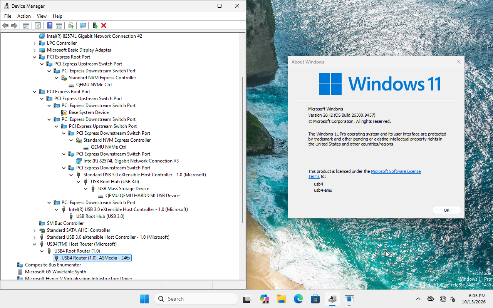

# usb4-emu

A Thunderbolt 3 / USB4 host emulator for QEMU. An unmodified OS's connection manager (CM)
enumerates the emulated routers and brings up a PCIe tunnel to an NVMe drive. It exists so
[xhci98](https://github.com/yeokm1/xhci98) can develop USB4/Thunderbolt drivers for
Windows 98 through Windows 7 without real hardware.



*Windows 11 (build 26300) with its in-box USB4 connection manager driving the emulator:
the host router, a device router reporting as ASMedia 246x, and the PCIe devices tunnelled
behind it, including QEMU NVMe drives, a NIC and an xHCI controller.*

## Status (2026-10-16)

**Windows 11's built-in USB4 CM** (build 26300, `usb4-generic` profile, no third-party
drivers):

- Binds `Usb4HostRouter.sys` through the ACPI `_OSC` grants, enumerates the host and device
  routers, reads the DROMs, bonds lanes and enables both PCIe paths.
- The tunnel comes up and QEMU's `nvme` appears behind it as a disk ("QEMU NVMe Ctrl",
  serial `USB4EMU01`). Formatted NTFS, a 64 MB file read back with a matching SHA-256,
  across a reboot too.
- Hot unplug and re-plug (`device_del` / `device_add`) work, on both USB4 ports
  independently, each with its own router and NVMe.
- Also working (launcher flags): a dock with a PCIe switch, NVMe, NIC and USB controller
  (`DOCK=1`); USB3 tunnelling (`USB3=1`); a daisy-chained second router (`CHAIN=1`);
  flags combine. A Thunderbolt 3 device router on the USB4 host (`dialect=tb3`, the
  CalDigit TS3 Plus as captured), including the ASM2464 enclosure behind it
  ([docs/USB4-HOSTS.md](docs/USB4-HOSTS.md) §8).
- The guest needs test-signing on (`bcdedit /set testsigning on`), or Windows' USB4 driver
  refuses the host router (Code 31). See [docs/WINDOWS-DEBUG.md](docs/WINDOWS-DEBUG.md).

**Linux** (Kubuntu 26.04 live, software CM) passes the M4 exit
([docs/LINUX-TEST.md](docs/LINUX-TEST.md)).

**Presets** on `usb4-generic`: `host-model=intel-adl` (the captured Framework 13 Alder
Lake host, 95.6% of captured register reads replayed identically), `host-model=asm4242`
and `host-model=amd` (public sources only), `device-model=asm2464` (the captured ORICO
ASM2464PD enclosure) and `preos-cm=on` (a firmware CM that builds tunnels before the OS).
See [docs/USB4-HOSTS.md](docs/USB4-HOSTS.md) and
[docs/PLATFORM-MATRIX.md](docs/PLATFORM-MATRIX.md).

**Windows 98 SE and 2000** on i440FX see the NVMe behind the `usb4-tunnel-bridge`, with the
tunnel forced up or brought up by the DOS reference CM `USB4CM.EXE`
([tools/usb4cm](tools/usb4cm/README.md)), and start with the volume mounted. The whole
controller tree can leave and come back (`root-hotplug=`). See
[docs/WIN98-TEST.md](docs/WIN98-TEST.md).

**Firmware-CM (Thunderbolt 3) profiles:**

- `tb3-alpine-ridge` models the P14s Gen 1's Intel JHL6240 Alpine Ridge LP, found by the
  first Linux capture (2026-10-14). Its wire contract is
  [docs/ICM-PROTOCOL.md](docs/ICM-PROTOCOL.md); capture tools are in
  [tools/p14s-capture](tools/p14s-capture/README.md).
- `tb3-titan-ridge` (JHL7540, `ports=1` for the 2C part) is modelled from the Linux ICM
  client alone and passes an unmodified Linux guest
  ([docs/ICM-TITAN-RIDGE.md](docs/ICM-TITAN-RIDGE.md)).
- Windows 11 with the Intel Thunderbolt driver package boots on both, but its smoke gate
  (M3) has not passed: the read-only DMA port (R20) and the Device Serial Number
  capability (R29) are still missing.

## Layout

| Path | Contents |
|---|---|
| `src/qemu/` | QEMU v11.1.2 working tree with our changes on branch `usb4-emu` (git-ignored). Device code in `hw/usb4/`. |
| `src/patches/0001-usb4-emu.patch` | The fork as one cumulative patch against v11.1.2 (committed). |
| `src/setup-qemu.sh`, `src/build-qemu.sh`, `src/export-patches.sh` | Recreate, build and export the fork. |
| `scripts/` | VM install/run/stop/revert scripts, guest command client, QMP client, CM test launcher. |
| `vms/` | Disk images, firmware vars, traces (git-ignored). |
| `docs/` | Design, roadmap, protocol and host-model notes, test reports, Windows debugging notes. `docs/captures/` holds write-ups of individual captures. |
| `docs/references/` | Third-party specs and sources (git-ignored; re-fetch per [docs/REFERENCES.md](docs/REFERENCES.md)). |
| `tests/captures/` | Register, sysfs, DROM and trace captures from real hardware (P14s Gen 1, Framework 13 12th gen). The source of truth for model behaviour. |
| `tools/usb4cm/` | Polling C89 reference USB4 connection manager for xhci98: OS-free core, host test against the fabric, DOS `USB4CM.EXE` (validated in the Windows 98 VM). See [tools/usb4cm/README.md](tools/usb4cm/README.md). |
| `tools/p14s-capture/` | Linux, Windows 11 and Windows 98 capture scripts for real hardware, plus `scrub.py` to remove identifying data. |
| `tools/reenum-test/` | Throwaway Windows 98 / 2000 re-enumeration experiment ([docs/REENUM-EXPERIMENT.md](docs/REENUM-EXPERIMENT.md)). |
| `tools/third-party/` | DDKs and NVMe driver sources used by the legacy-guest tests (git-ignored). |

## Quick start (Windows host, Git Bash, from the repo root)

### 1. Toolchain and QEMU build

The MSYS2 UCRT64 toolchain lives in `toolchain/msys64` ([docs/TOOLCHAIN.md](docs/TOOLCHAIN.md)).

```bash
src/setup-qemu.sh                       # only if src/qemu does not exist yet
scripts/msys2-shell.sh "$PWD/src/build-qemu.sh"
```

The binary is `src/qemu/build/qemu-system-x86_64.exe`. Run `ninja -C build install` inside
`src/qemu` (through the MSYS2 shell) to get `build/install` with firmware, and copy that
tree to `vms/qemu-baseline/`, which the VM scripts use for firmware and `qemu-img`.

### 2. Windows 11 test VM (one-off, about 12 minutes)

```bash
scripts/win11-install.sh                # unattended install from D:\isos\Windows11_*.iso
```

This creates `vms/win11/` (q35, WHPX, OVMF without Secure Boot, AHCI boot disk), a local
account `usb4`/`usb4` with autologon, and a guest command agent, then takes the internal
snapshot `base-install`. `scripts/win11-revert.sh` returns to it. Never boot `vms/win11`
directly once overlays exist; use overlays as below.

### 3. Run the USB4 demo

```bash
scripts/run-cm-test.sh                  # overlay vms/win11-cm, ports 47301/47302/47310
```

On first use of a new overlay, enable test-signing once and restart:

```bash
VM_DIR=$PWD/vms/win11-cm python scripts/guest.py exec "bcdedit /set testsigning on"
VM_DIR=$PWD/vms/win11-cm scripts/stop-win11.sh
scripts/run-cm-test.sh
```

Then check from the host:

```bash
VM_DIR=$PWD/vms/win11-cm python scripts/guest.py exec "Get-Disk; Get-PnpDevice -PresentOnly | ? FriendlyName -match 'USB4|NVM'"
```

Watch it with a VNC viewer on `127.0.0.1:47302`. The model's trace is in
`vms/win11-cm/usb4-trace.log`. Stop with `VM_DIR=$PWD/vms/win11-cm scripts/stop-win11.sh`.

Hot unplug and re-plug of the device router while the VM runs (QMP port from
`vms/win11-cm/ports.env`):

```bash
VM_DIR=$PWD/vms/win11-cm python scripts/qmp.py cmd device_del '{"id":"enc0"}'
VM_DIR=$PWD/vms/win11-cm python scripts/qmp.py cmd device_add '{"driver":"usb4-device","id":"enc0","bus":"u4.0","port":1,"drive":"nvme0","serial":"USB4EMU01"}'
```

### QEMU command line

What `scripts/run-cm-test.sh` adds to a q35 machine:

```
-global ICH9-LPC.acpi-pci-hotplug-with-bridge-support=off
-device usb4-tunnel-port,id=tp0,bus=pcie.0,addr=5.0,chassis=1,slot=1
-device usb4-tunnel-port,id=tp1,bus=pcie.0,addr=6.0,chassis=2,slot=2,usb4-port=1
-device usb4-host,id=u4,bus=pcie.0,addr=4.0,tunnel-port=tp0,tunnel-port2=tp1
-drive if=none,id=nvme0,format=qcow2,file=nvme.qcow2
-device usb4-device,id=enc0,bus=u4.0,port=1,drive=nvme0,serial=USB4EMU01
-drive if=none,id=nvme1,format=qcow2,file=nvme2.qcow2
-device usb4-device,id=enc1,bus=u4.0,port=2,drive=nvme1,serial=USB4EMU02
-trace usb4_* -D usb4-trace.log
```

- `usb4-host` must sit on the root bus at an even slot, function 0, so its ACPI node
  name (`\_SB.PCI0.Sxx`) ends in 0-7 as Windows requires.
- `tunnel-port` / `tunnel-port2` name the tunnel root port behind USB4 port 1 / 2.
  `PORT2=0` in the launcher gives the single-port setup.
- The `-global` hands the tunnel port's hot-plug to native PCIe hot-plug.
- `usb4-device` is the device router; its `drive`/`serial` become the NVMe behind the
  tunnel when the CM brings the tunnel up. It is hot-pluggable.
- The tunnel can also be forced without any CM (`qom-set /machine/peripheral/tp0 tunnel
  up|down|eject|surprise`); see [docs/USAGE-tunnel.md](docs/USAGE-tunnel.md), which also
  covers the i440FX `usb4-tunnel-bridge` for legacy guests.

### Guest helper commands

- `python scripts/guest.py exec "<powershell>"`, `put <local> <guest>`,
  `get <guest> <local>`, `wait`. Commands run as SYSTEM in the guest.
- `python scripts/qmp.py screendump x.png | cmd <name> [json] | hmp '<cmd>'`.
- Set `VM_DIR` to choose the VM (default `vms/win11`).
- Guest reboots restart QEMU under `scripts/vm_supervisor.py`, because WHPX on this
  host cannot reset a guest in place.

## Debugging

- QEMU side: `-trace 'usb4_*'` decodes every ring 0 control packet, router operation,
  hot-plug event, and the tunnel evaluator's inputs (`usb4_tunnel_inputs`,
  `usb4_tunnel_path` say why a tunnel is not up).
- Windows side: `C:\usb4agent\guest-usb4-trace.ps1 start|stop|collect` captures the USB4
  drivers' ETW. Their TraceLogging assertion events name the failing check. Details in
  [docs/WINDOWS-DEBUG.md](docs/WINDOWS-DEBUG.md).
- Tests: `src/qemu/tests/usb4/run-fabric-test.sh` (standalone CM harness for the fabric);
  the capture-replay conformance checks `run-adl-conformance.sh`,
  `run-asm2464-conformance.sh`, `run-chain-conformance.sh` and `run-tb3-conformance.sh` in
  the same directory ([docs/USB4-HOSTS.md](docs/USB4-HOSTS.md) §2); and the qtests
  `usb4-host-test`, `usb4-tunnel-test`, `usb4-icm-test`, `usb4-icm-tr-test`,
  `usb4-harness-test`, `usb4-tb3dev-test`, `usb4-asm2464-test`, `usb4-asm4242-test` and
  `usb4-root-hotplug-test` in `src/qemu/build/tests/qtest/`.

## Licence

GPL-2.0-only, the same as xhci98. See `LICENSE`,
`NOTICE` for incorporated third-party material, and `AGENTS.md` "Licence rules" for how
Linux (GPL-2.0-only), FreeBSD (BSD-2-Clause) and Intel tbtools (MIT) code may be adapted.
